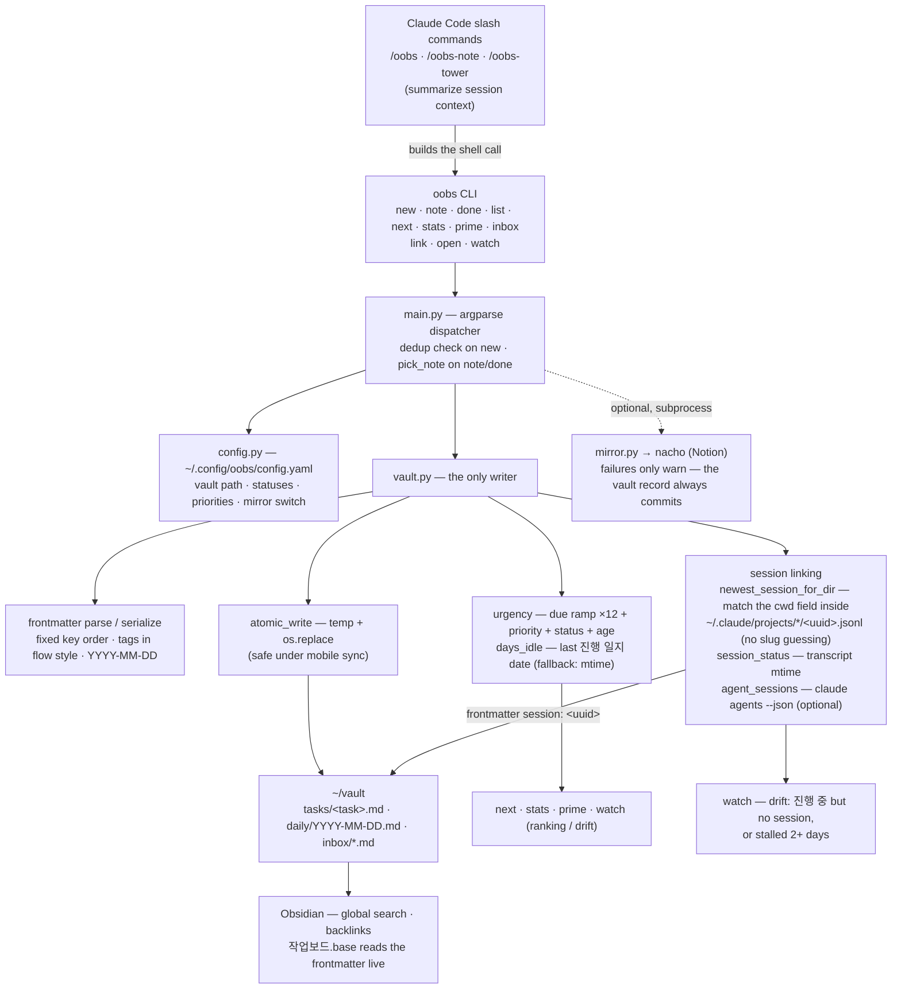

# oobs

A CLI that creates task notes in an Obsidian "control tower" vault (`~/vault`) and **links them to Claude Code sessions**, turning the vault into a task-orchestration control tower.
Same pattern as nacho (Notion) and tako (Jira) — **deterministic file edits are handled by code, session-context summarization by Claude slash commands**.

## Three surfaces

A task is handled across three surfaces, all sitting on the **same data (vault + Claude Code sessions)**. They don't overlap.

```
 Obsidian          = long-term memory / archive / search   (past + present, frontmatter views / Bases)
 Control tower /oobs-tower = active conversational management   (synthesis / drift / registration / reports)
 Agent View        = live driving                          (claude agents, attach/detach)
```

Core principle: the task ↔ session link is **data** (the frontmatter `session:` UUID), not process ownership.
→ Monitoring (observing notes) and driving (working inside a session) run independently. Closing the control tower leaves child sessions alive.

## Architecture

Everything is a local file edit. `vault.py` is the only thing that touches the vault, and every write goes through `atomic_write` (temp file + `os.replace`).



## Install

```bash
./install.sh
```

Installs a venv + links `~/.local/bin/oobs` + registers the `/oobs`, `/oobs-note`, `/oobs-tower` slash commands
+ creates `~/.config/oobs/config.yaml` + drops `작업보드.base` (an Obsidian Bases dashboard) into the vault.

## Commands

```bash
# Tasks
oobs new --title "WL-1234 sort bug" --status "진행 중" --repo crow-backend \
         --due 2026-06-30 --priority high --note "investigating cause" --body "background..."
oobs note "sort bug" "PR merged, verifying on staging" --status "배포 대기"
oobs done "sort bug" "deployed to production"   # --cancel to cancel instead

# Queries
oobs list [--all | --status "보류"]            # task table (default: in-progress only)
oobs next [N]                                  # top N by urgency — what to do now?
oobs stats                                     # in-progress / overdue / stalled (14d+) summary
oobs prime                                     # vault context digest for session startup
oobs watch                                     # task ↔ session state + drift detection

# Session linking (control tower)
oobs link "sort bug" --dir ~/dev/crow-backend  # auto-links the latest session in that directory
oobs open "sort bug"                           # command to resume a closed session (live ones → Agent View)

# Misc
oobs inbox a todo that just popped into my head # quick note before triage
oobs help [command]                            # example-driven manual
```

Status values: `시작 전 | 진행 중 | 배포 대기 | 모니터링 | 의사결정 대기 | 보류 | 취소 | 완료`
(*not started | in progress | awaiting deploy | monitoring | awaiting decision | on hold | cancelled | done* — the vault is Korean-first, so these are the literal strings the tool accepts).
`new` **refuses to create** when a similar-titled in-progress task already exists (dedup; use `--force` if it really is new).
All writes are atomic (temp + rename), in anticipation of mobile sync. The frontmatter schema is kept identical to `~/vault/CLAUDE.md`.

## Control tower — task ↔ Claude Code session

Link a task note to a session and use the vault as a control tower. The link is the frontmatter `session:` (UUID) — data, not a process.

```
                         ~/vault  (source of truth)
        tasks/<task>.md ──frontmatter  session: <uuid>──┐
                  ▲                                      │  data link
       oobs read/write (watch·link·note)                │ (not process ownership)
                  │                                      ▼
   ┌──────────────┴──────────────┐         ┌────────────────────────────┐
   │ Control tower  /oobs-tower   │ observe │ N child task sessions (indep) │
   │ = flight-strip board         │ ──────▶ │ = actual driving (code·run)  │
   │ synthesis·drift·register·report │      └──────────────┬─────────────┘
   │ (does not drive / enter)     │           if alive →    │
   └─────────────────────────────┘         ┌──────────────▼─────────────┐
                                           │ Agent View (claude agents)  │
                                           │ = radar: live state + attach │
                                           └─────────────────────────────┘
```

The two screens are complementary — **Agent View** (the radar) shows "session is working/idle" and lets you attach and drive,
while the **control tower** (the strip board) shows "that's WL-1234, due Friday, stalled 3 days" and **even tasks with no session at all**.

- `oobs watch` — a board merging task + session state. Warns of **drift** when something is in-progress but has no session, or is stalled 2+ days.
- `oobs link "<task>" --dir <repo>` — auto-links the session you just launched in that directory (a UUID can also be given directly).
- `oobs open "<task>"` — command to resume a **closed** session (`claude --resume`). For live sessions it tells you to attach via Agent View.
- `/oobs-tower` — turn this session into the control-tower operator (synthesis·drift·register·report only; driving stays in Agent View).

Live session state is read from `claude agents --json` (Agent View); when claude is absent it's inferred from transcript-file mtime
(optional integration — the core knows nothing about claude, same subprocess boundary as the mirror). Spawning bg sessions is an interactive in-session action,
so oobs doesn't launch them — it only **registers** them via `link`.

## Obsidian dashboard (Bases)

Open the vault's `작업보드.base` in Obsidian and you get **in-progress board / by-due-date / completed archive / by-repo** views.

- Bases **reads the frontmatter oobs writes, live** → `oobs new/note/done` is **reflected on the board automatically** (no export/sync).
- Completing a task doesn't delete the note (it stays `status: 완료`) → past tasks accumulate permanently, explorable via global search and backlinks.
- But **live session state (working/idle) lives outside frontmatter**, so the board only shows the "linked session name" — for real-time, use `oobs watch`.

What you did in Notion (search, DB views, relations, properties) maps directly onto Obsidian (global search, Bases, backlinks, frontmatter).

## urgency

A port of Taskwarrior's weighted sum onto the vault schema — a 21-day due-date ramp (×12) + priority (high 6 / normal 3.9 / low 1.8)
+ status (awaiting-deploy +5, in-progress +4, on-hold −3, etc.) + task age (up to +2). `oobs next` surfaces the top of this score.

## Dependencies and coupling

**The oobs core is standalone** — no dependencies beyond PyYAML, and it works end-to-end with just the vault, no nacho/tako.
Session linking calls `claude agents --json` via subprocess (optional integration), but falls back to mtime when claude is absent — the core never imports claude.
The nacho mirror is likewise isolated to a single `mirror.py` file and is a subprocess call, so it knows nothing of nacho's internals. To remove it:

1. Turn off operationally: `mirror: false` in `config.yaml` (no code change).
2. Remove entirely: delete `oobs/mirror.py` + the two `mirror.enabled()` guards in `main.py` + the `nacho:` section from config.

## Design — why a CLI + thin skill instead of an MCP server

MCP's context cost comes not from calls but from **residency**. Attach an MCP server and its tool schemas ride in the system prompt of *every* session —
thousands to tens of thousands of tokens even in sessions that never use it. A CLI + thin skill converts that residency cost into a per-call cost:

- **Residency cost**: just one line of skill description (tens of tokens). Usage knowledge loads only at the moment `/oobs` is invoked.
- **Direct shell calls outside a session = 0 tokens** + deterministic behavior + testable / version-controlled.
- oobs is local file manipulation anyway, so wrapping it in an MCP server is pure overhead.

Trade-off: recent Claude Code lazy-loads MCP tools (ToolSearch), so the residency gap is smaller than it used to be, and typed schemas
help reduce malformed calls. But oobs touches local files, so that benefit is small here.

## Notion mirror (transitional, optional)

`new`/`note`/`done` can send the same content to Notion via nacho.

- Switch: `mirror:` in `~/.config/oobs/config.yaml` — `auto` (default, mirror if nacho is present) | `true` | `false`.
- Needs a nacho that supports `new --no-prompt` (nacho#1). With an older nacho the mirror fails with a warning; the vault record is unaffected.
- One-off skip: `--no-mirror`. Categories/projects not present in the Notion options are auto-skipped from the mirror (the vault still records free-form values).
- Mirror failures only warn — the vault record (the original) is always committed.

## Tests

Standard-library `unittest` only — no pytest, no network, no real vault. Everything runs against `tempfile` dirs (including fixture `.jsonl` transcripts for session lookup).

```bash
python -m unittest discover -s tests -v   # all
python -m unittest tests.test_vault       # a single module
```

`tests/test_vault.py` covers the pure core: `safe_filename`, frontmatter round-trip (key order / flow-style tags), `append_progress` (creates the section, appends inside it, never spills into the next `##`), `urgency` (due ramp, priority, status, age cap), `days_idle`, `atomic_write` (including keeping the file mode), YAML-special values (`배포: 완료`, `[WIP]`, `#3`) surviving a round-trip, a malformed `due` not crashing `urgency`, and `newest_session_for_dir` (cwd matching, newest-wins, no match → `None`). `tests/test_mirror.py` pins the nacho call contract: `--no-prompt`, `--session-id` passed through, no fake stdin.

## Layout

```
oobs/
├── main.py    subcommands·flags (new/note/done/list/next/stats/prime/inbox + watch/link/open)
├── vault.py   frontmatter parse/serialize, atomic writes, daily notes, search, urgency, session link/observe
├── mirror.py  non-interactive nacho call (`nacho new --no-prompt`)
└── config.py  ~/.config/oobs/config.yaml + status/priority constants
tests/
└── test_vault.py  stdlib unittest — pure vault logic (tempfile only, no network)
commands/
├── oobs.md        /oobs       — create a task note from session context
├── oobs-note.md   /oobs-note  — log progress
└── oobs-tower.md  /oobs-tower — control tower (synthesis·drift·register·report)
templates/
└── 작업보드.base  Obsidian Bases dashboard (install.sh drops it into the vault)
```
